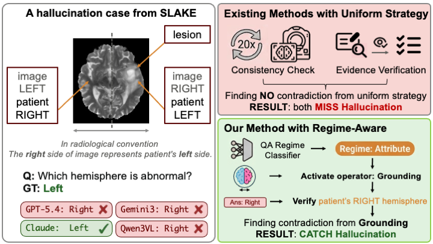
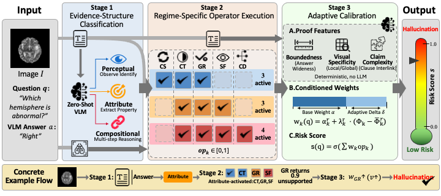

# 🛡️ PROVE

<p align="center">
  
  
  
  
  
</p>

**P**roof-guided **R**egime-aware **O**perator **VE**rification for hallucination detection in medical visual question answering.

Frontier VLMs used for medical VQA can give fluent but wrong answers — laterality flips, fabricated findings, misidentified modalities — that are dangerous in a clinical setting. Most black-box detectors apply the **same** check to every question (re-sample for consistency, or run a generic evidence loop). That fails in both directions: a systematic error is invisible because every re-query repeats it, and a simple perceptual question is over-verified and flagged by accident.

**PROVE** adapts verification to the *kind of visual proof* the question needs. It classifies each question into one of three regimes, runs only the matching operators, and turns their scores into a hallucination risk in `[0, 1]`. The detector is black-box: it needs an OpenAI-compatible vision chat API, not model weights, attention maps, or logits.

<p align="center">
  
</p>

**📌 Figure 1.** Motivating case from SLAKE. Three of four VLMs answer “Right” for a left-hemisphere lesion because they report image-space laterality instead of radiological convention. Uniform consistency and evidence checks find no contradiction. PROVE labels the question as **attribute**, activates **grounding**, and catches the mismatch.

<p align="center">
  
</p>

**📌 Figure 2.** PROVE pipeline. Stage 1 classifies the evidence structure (perceptual / attribute / compositional). Stage 2 runs the regime-specific operator subset. Stage 3 computes deterministic proof features and a calibrated risk score.

This folder is the paper release: the final three-stage method, with prompts copied from the supplementary material. It does not include historical prototypes, per-category research sweeps, cached runs, or vendor-specific API endpoints.

```
Image I, question q, VLM answer a
        │
        ▼
 Stage 1  Regime classifier (text-only)
        │   perceptual | attribute | compositional
        ▼
 Stage 2  Regime-specific operators (K-round black-box queries)
        │   consistency · contrast · grounding · sufficiency · claim decomp
        ▼
 Stage 3  Adaptive calibration
        │   w_k = α_k + λ_k (φ_k − φ̄_k)
        │   risk = σ( Σ w_k · op_k + b )
        ▼
 Hallucination risk s ∈ [0, 1]
```

## 🧩 Method (paper Sections 3.1–3.5)

### ① Stage 1 — Evidence-structure regimes

A zero-shot text-only call classifies `(q, a)` into one of three verification regimes, based on the proof chain the question demands rather than topic or surface form.

| | Regime | What must be verified | Typical failure | Operators |
|--|--------|----------------------|-----------------|-----------|
| 👁️ | **Perceptual** | One entity or a global image property | Language-prior answers that flip under rephrasing | consistency, contrast, grounding |
| 🏷️ | **Attribute** | An identified entity plus a property (size, laterality, normality) | Stable but ungrounded confabulation | contrast, grounding, sufficiency |
| 🧩 | **Compositional** | Multiple observations / spatial relations / open description | Partially correct multi-claim answers | contrast, grounding, sufficiency, claim decomp |

Routing follows paper Table 1. Operators that do not match a regime are **excluded**, not down-weighted.

### ② Stage 2 — Five operators

Every operator elicits independent evidence and compares it with the baseline answer. Scores are structurally grounded (vote fractions), not LLM self-reported confidence. The paper uses **K = 3**.

| | Operator | What it does | Score |
|--|----------|--------------|-------|
| 🔁 | **Consistency** | Generate 2 rephrasings, re-ask on the image, judge equivalence | fraction not equivalent |
| ⚖️ | **Contrast** | Independent verifier answer vs. baseline, judged K times | `n_disagree / K` |
| 🎯 | **Grounding** | Describe visual evidence without answering, then judge support | `n_unsupported / K` |
| 🧪 | **Sufficiency** | Ask whether the image can support the answer | `n_insufficient / K` |
| ✂️ | **Claim decomp** | Split the answer into atoms and verify each against the image | fraction of atoms that fail |

Prompts live in [`prove/prompts.py`](prove/prompts.py) and match **Supplementary Section A**.

### ③ Stage 3 — Adaptive calibration

Three deterministic features are computed from text (paper Eqs. 1–3), with **no extra LLM calls**:

| Feature | Symbol | Meaning |
|---------|--------|---------|
| Answer boundedness | β | `½ [ 1/log₂(\|A_q\|+1) + 1/(1+\|a\|tokens) ]` |
| Visual specificity | ν | `1 − 1/(1 + \|tokens(q) ∩ L_visual\|)` |
| Claim complexity | κ | `1 − 1/(1 + n_clauses(a))` |

Each operator is paired with one feature (Table 1): consistency → `(β+κ)/2`, contrast → `β`, grounding → `ν`, sufficiency → `1−ν`, claim decomp → `κ`.

```
w_k(q) = α_k^r + λ_k^r · (φ_k(q,a) − φ̄_k^r)
s(q)   = σ( Σ_{k ∈ O_r} w_k(q) · op_k(q) + b_r )
```

Default `α` and `b` are the published VQA-RAD-fitted weights (main paper Table 2). Default `λ = 0`, which is the **regime-routing** model in the paper ablation. Fit `λ` on labeled operator scores with `scripts/fit_calibration.py` (sklearn L2 logistic regression, `C=0.1`, seed 42).

## 🤗 Datasets

Place official releases under [`data/`](data/). Paths are defined in [`data/__init__.py`](data/__init__.py). Images and converted JSONL are **not** shipped; download them yourself.

The paper’s 8,048-row evaluation uses **SLAKE**, **VQA-RAD**, and **VQA-Med-2019**. **PMC-VQA** is a fourth public set with the same local layout if you want to run extra experiments.

| | Dataset | Hugging Face | Local path after prep | Splits |
|--|---------|--------------|----------------------|--------|
| 🩻 | **SLAKE** | [`BoKelvin/SLAKE`](https://huggingface.co/datasets/BoKelvin/SLAKE) | `data/slake/` | train / val / test |
| 🏥 | **VQA-RAD** | [`flaviagiammarino/vqa-rad`](https://huggingface.co/datasets/flaviagiammarino/vqa-rad) | `data/vqa_rad/` | train / test |
| 🗂️ | **VQA-Med-2019** | [`claudioreeves/imageclef-vqa-med-2019`](https://huggingface.co/datasets/claudioreeves/imageclef-vqa-med-2019) | `data/vqa_med_2019/` | train / val / test |
| 📚 | **PMC-VQA** | [`xmcmic/PMC-VQA`](https://huggingface.co/datasets/xmcmic/PMC-VQA) | `data/pmc_vqa/` | train / test |

Expected layout (JSONL + images). `image_path` is relative to each `images/` folder:

```
data/
  slake/
    images/xmlab*/source.jpg
    train.jsonl  val.jsonl  test.jsonl
  vqa_rad/
    images/
    train.jsonl  test.jsonl
  vqa_med_2019/
    images/
    train.jsonl  val.jsonl  test.jsonl
  pmc_vqa/
    images/
    train.jsonl  test.jsonl
```

JSONL line:

```json
{"image_path": "xmlab447/source.jpg", "question": "Which hemisphere is abnormal?", "answer": "Left"}
```

Check what is on disk:

```bash
python -m data
```

Load a prepared split:

```python
from data import load_split, is_prepared

assert is_prepared("slake", "test")
rows = load_split("slake", "test")
print(rows[0]["question"], rows[0]["image_path_resolved"])
```

SLAKE is bilingual; the paper keeps **English** items only (`q_lang=en`). PMC-VQA is large (images on the order of tens of GB) — download it only if you need it. Respect each dataset’s original license.

## ⚙️ Setup

Python 3.10+.

```bash
pip install -r requirements.txt
```

Or: `pip install -e .`

Copy [`.env.example`](.env.example) and export **your own** OpenAI-compatible credentials. Do **not** commit API keys. This repo does not ship vendor-internal endpoints or keys.

```bash
export PROVE_API_KEY=sk-...
export PROVE_BASE_URL=https://api.openai.com/v1
export PROVE_MODEL=gpt-4o
```

Any OpenAI-compatible vision chat endpoint works. The paper’s default verifier is GPT-5.4.

## 🚀 Usage

Three bundled examples (SLAKE laterality MRI, SLAKE chest X-ray, CT ribs):

```bash
python scripts/infer.py \
  --image examples/brain_mri_laterality.jpg \
  --question "Which hemisphere is abnormal?" \
  --answer Right
```

JSONL batch ([`examples/sample.jsonl`](examples/sample.jsonl)):

```bash
python scripts/infer.py \
  --input examples/sample.jsonl \
  --output outputs/scored.jsonl \
  --k 3 --workers 4
```

Python API:

```python
from prove import PROVE

detector = PROVE(k=3)
result = detector.score(
    image="examples/brain_mri_laterality.jpg",
    question="Which hemisphere is abnormal?",
    answer="Right",
)
print(result["regime"], result["risk"], result["operator_scores"])
```

Evaluate scored JSONL that includes labels:

```bash
python scripts/evaluate.py --pred outputs/scored.jsonl --label-key label
```

Fit calibration on a labeled training JSONL (already scored by `infer.py`):

```bash
python scripts/fit_calibration.py \
  --input outputs/train_scored.jsonl \
  --output configs/fitted_weights.json
```

Then pass `--weights configs/fitted_weights.json` to `infer.py`.

Useful flags:

| Flag | Effect |
|------|--------|
| `--k 3` | Voting rounds (paper default) |
| `--regime attribute` | Skip the classifier |
| `--operators grounding,sufficiency` | Override routing (ablations) |
| `--no-details` | Drop bulky operator traces |
| `--resume` | Skip `sample_id`s already in `--output` |

## 📁 Repository layout

```
prove/                   # Algorithm 1 library
  pipeline.py            # three-stage inference
  regime.py              # Stage 1 + Table 1 routing
  operators/             # five operators
  prompts.py             # Supplementary Section A
  features.py            # β, ν, κ
  lexicon.py             # L_visual (~300 terms)
  calibration.py         # Stage 3
  api.py                 # OpenAI-compatible client (env keys only)
data/                    # local dataset roots (download yourself)
  __init__.py            # paths, load_split, is_prepared
  slake/ vqa_rad/ vqa_med_2019/ pmc_vqa/
docs/fig1.png docs/fig2.png
examples/                # three demo images + sample.jsonl
configs/paper_weights.json
scripts/infer.py evaluate.py fit_calibration.py
```

## 📦 What this release is

Included:

- ✅ The final PROVE method from the paper (three stages, five operators, published prompts and Table 2 weights)
- ✅ Deterministic proof features and the visual lexicon
- ✅ Inference, AUROC evaluation, and calibration fitting
- ✅ Paper Figures 1–2 and three demo images
- ✅ Path registry for four public VQA datasets

Not included:

- ❌ Cached operator runs or hallucination labels
- ❌ Full benchmark images (download from the Hugging Face links above)
- ❌ Retired operators (answer-type / semantic-coverage)
- ❌ Dual-loop prototypes and rebuttal baseline reimplementations
- ❌ Hardcoded vendor API bases or keys

Paper evaluation (for reference): 8,048 test samples across SLAKE, VQA-RAD, and VQA-Med-2019, four frontier VLMs as answerers, GPT-5.4 as the default cross-model verifier, K = 3. Parameters are fitted on VQA-RAD training only (7,168 samples). Reported overall AUROC is 0.821.

## ✅ Tests

```bash
python -m unittest tests/test_features.py
```

These cover proof-feature formulas, Table 1 routing, and Table 2 risk arithmetic. They do not call any API.

## 📜 Citation

```
@inproceedings{prove2026,
  title     = {PROVE: Proof-guided Regime-aware Operator Verification
               for Hallucination Detection in Medical Visual Question Answering},
  booktitle = {Proceedings of the 34th ACM International Conference on Multimedia},
  year      = {2026}
}
```

## 📄 License

MIT for this code (see [LICENSE](LICENSE)). Benchmark images and QA pairs remain under their original dataset licenses.
